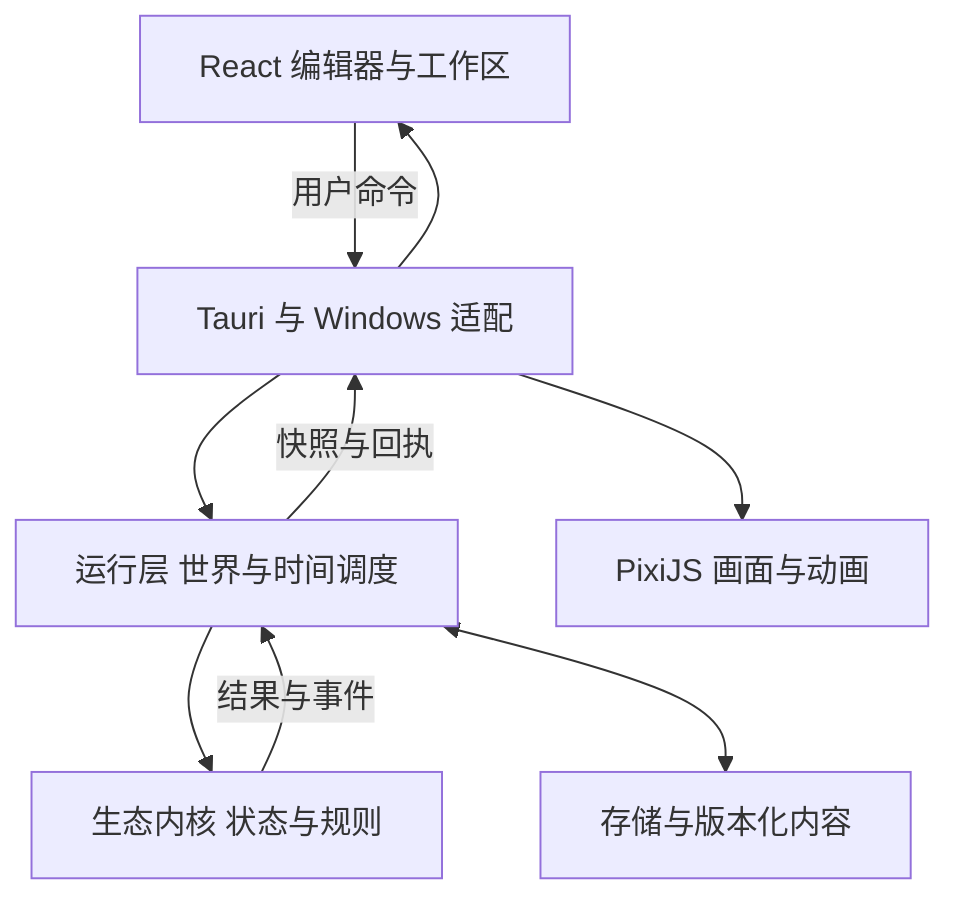

# 系统架构与数据合同

版本：0.1 审查草案。日期：2026-11-24。对象：接手审查与后续开发的 Codex。

## 1. 文档状态与开工边界

本文使用统一状态：**D** 为用户明确决定，**B** 为当前工作基线或默认建议，**O** 为需要审查、实验或进一步决定的事项。B 可以作为审查基础，但不能伪装成已经验证的事实。

当前只允许资料审查与补齐审查文档。首次工作结果写入 `review/01-audit.md`、`review/02-questions-and-decisions.md`、`review/03-implementation-plan.md`、`review/04-readiness.md`。完成审查且用户明确授权开始后，才建立工程、安装项目依赖或编写产品实现。M0 原型也属于开发。首次审查后必须获得真实开工授权；若用户授权整个确认计划，可在该范围内按里程碑连续推进，若只授权 M0，则在 M0 完成后停止。只有超出授权范围、出现重大新取舍或受影响阶段仍有阻塞时再询问，不为每个阶段增加形式性批准。

### 1.1 技术基线

| 项目 | 状态 | 约束 |
| --- | --- | --- |
| Windows 桌面目标 | D | 最低系统版本、CPU 架构与安装形式在审查中明确 |
| Tauri 2、React 19、TypeScript、PixiJS 8、Rust | D，暂定技术栈 | 不自行换栈；具体兼容版本组合由开发前官方资料核对后锁定 |
| WebGL 作为首轮稳定渲染路径 | B | WebGPU 单列能力实验，不能成为基础功能可用的前提 |
| Rust 维护权威世界状态 | B | 前端不另写一套摄食、生长、死亡和资源规则 |
| 核心无界面运行 | B | 支持在无 Tauri、无绘制环境中推进、保存数据与验证结果 |
| Windows 性能及窗口能力 | O | 尚未实测；不能从网页演示推断实机效果 |

技术版本核对至少涵盖 Rust 工具链、Tauri CLI/核心/插件、WebView2 条件、Node 与包管理器、React 与 PixiJS 的当前兼容 API。版本核对用于落实已选技术栈，不扩展成没有具体风险依据的换栈讨论。

## 2. 模块职责与依赖方向



| 模块 | 拥有或负责的状态 | 允许依赖 | 明确边界 |
| --- | --- | --- | --- |
| `eco-core` | 世界数据类型、生态规则、合法命令、一次模拟步的结果 | 明确输入的定义、时长、外部驱动、确定性随机状态 | 不读系统时钟、窗口、文件、网络；不调用 Tauri |
| `world-runtime` | 世界实例、运行模式、调度、订阅、命令队列、保存协调 | 内核、计时/存储/内容等接口 | 每个世界只有一个写入者；负责决定何时调用内核 |
| Tauri/Windows 适配 | 桌面窗口生命周期、平台事件、IPC 路由 | 运行层接口及必要平台能力 | 不直接修改生物状态；系统睡眠的语义在此转换 |
| React 界面 | 当前工具、选中对象、表单、拖动预览、工作区布局 | 应用客户端接口、只读视图状态 | 编辑预览在提交前不影响正式世界 |
| PixiJS 视图 | 精灵、纹理、相机、显示层、插值、装饰动画 | 内容素材、视图快照 | 不决定死亡、摄食或生长；渲染帧不能驱动生态时间 |
| 内容模块 | 主题、物种、材料、预设、素材映射及其版本 | 校验/解析工具 | 已运行世界绑定明确版本，禁止静默套用更新参数 |
| 存储模块 | 检查点、世界索引、工作区布局与历史记录 | 序列化与文件存储接口 | 不决定生态规则；保存一致快照 |

建议以 Rust 工作区组织核心与应用适配；前端按交互、渲染、IPC 合同分区。具体目录可由 Codex 在审查报告中调整，只要不改变依赖方向。

| 建议工程位置 | 用途 |
| --- | --- |
| `crates/eco-core/` | 不依赖桌面宿主的内核 |
| `crates/world-runtime/` | 世界管理、调度与生命周期策略 |
| `apps/desktop/src-tauri/` | Tauri 应用入口、平台适配与权限配置 |
| `apps/desktop/src/features/` | React 主题选择、编辑器、工作区与设置 |
| `apps/desktop/src/render/` | PixiJS 场景、素材加载与状态表现 |
| `apps/desktop/src/bridge/` | 前端命令/快照合同、错误映射 |
| `content/` | 经校验、版本化的主题与预设 |
| `tests/fixtures/` | 固定参数、输入序列与存档样本 |

这些是待建立工程的目录建议；本资料包并未创建该工程。

## 3. 世界与视图的所有权

**ARC-001：一个世界一个权威实例。** 世界以 `worldId` 标识。一个大窗口、一个小组件和一个环境信息面板可以订阅同一世界；订阅数不影响模拟次数。每个世界的写操作按确定顺序串行处理。

**ARC-002：多个世界不共享可变实例。** 共享只读物种与素材定义可以复用；水分、养分、随机生成器、日历和环境过渡等可变状态由各世界独立拥有。允许深拷贝相同初始数值，也允许试运行副本完整复制随机状态后独立推进；数值相等不表示共享可变对象。实体身份为 `(worldId, entityId)`：复制生成新的 `worldId`，副本内可保留原 `entityId` 以便比较，跨世界引用必须带世界 ID。跨视图消息还携带 `runGeneration`，避免旧运行实例污染新实例。

**ARC-003：编辑草稿、试运行副本、正式世界有不同运行身份。** 试运行深拷贝完整模拟状态，创建独立世界身份与运行代次，并记录创建时正式世界的 `forkBase = (worldId, runGeneration, editRevision, simulationTick)`。副本的事件、保存路径和快照不能自动写回正式世界。采用结果必须执行第 5.3 节的冲突检查与状态映射；正式世界身份保留，运行代次更新，全部视图重新同步。

**ARC-004：界面状态与生态状态分别保存。** 相机缩放、组件边框、画面裁切或图层显示不改变真实生态面积、资源存量和生物尺寸。需要改变物理尺寸的操作使用独立命令，并说明后果。

首版可以采用简单数据容器和明确的系统函数；是否引入 ECS、任务图或专门状态管理库是常规工程选择，需基于测量或维护需要说明，不作为用户必须回答的产品问题。

## 4. 数据模型的最小边界

| 数据实体 | 最小内容 | 版本与身份 |
| --- | --- | --- |
| `ThemeDefinition` | 气候、边界交换、允许的材料/生物、模型开关 | `themeId` 与内容版本 |
| `SpeciesDefinition` | 生命阶段、摄食资源、环境响应、资源组成、行为参数、素材映射 | 稳定物种 ID 与定义版本；候选物种不等于已校准 |
| `MaterialDefinition` | 遮蔽、储水、可通行、可分解属性和画面素材 | 稳定材料 ID 与版本 |
| `PresetDefinition` | 初始布局、物质存量、生物配置、环境驱动、初始种子及参数引用 | 预设 ID、版本、内容依赖 |
| `WorldState` | 空间、生物、非生物资源、当前环境、模拟时间、随机状态、待完成过程 | 世界 ID、存档格式版本与模型版本 |
| `WorkspaceLayout` | 组件类型、位置、大小、叠放、相机、绑定世界 | 独立布局版本 |
| `WorldEvent` | 发生的变化、相关对象、模拟时刻、对应计算证据 | 事件 ID 或顺序号；与视觉快照分开 |

### 4.1 单位与计数

在合同中写明单位。物理坐标与屏幕坐标分离；世界尺寸不由画布像素推算。质量、水量、时间、温度、浓度不能使用未说明含义的裸数字。具体基础单位在实现前统一，显示单位可以转换。

建议跨 JSON 的长期整数计数（如 `simulationTick`、修订号、累计微秒）使用十进制字符串，或证明数值始终处于 JavaScript 安全整数范围。所有非有限数值、非法负存量、缺失必填字段和不支持的版本应形成可诊断错误。

### 4.2 版本并非一个数字

| 标识 | 含义 | 变化时机 |
| --- | --- | --- |
| `worldId` | 用户世界身份 | 新建/复制世界 |
| `runGeneration` | 当前加载或运行实例代次 | 重新加载、采用试运行结果、恢复检查点等 |
| `simulationTick` | 已完成模拟步计数 | 完成一次生态步 |
| `editRevision` | 用户编辑与干预的并发修订 | 成功提交一组编辑或干预 |
| `commandId` | 一次逻辑操作身份 | 用户发起新操作；重试沿用原 ID |
| `streamSequence` | 一次订阅流的数据次序 | 发送新快照 |
| `schemaVersion` | 持久化结构版本 | 存档结构迁移 |
| `modelVersion` | 模型算法语义 | 生理过程、数值规则或解释方式变更 |
| `definitionBundleVersion/hash` | 解析到的内容定义集 | 物种、材料、主题参数版本变化 |

`editRevision` 不能随每个模拟步增长。否则实时世界会让尚未提交的编辑不断发生无意义冲突。并发版本通过后仍需检查当前对象是否存在、资源是否足够、世界模式是否允许该操作。

## 5. 用户命令合同草案

以下 JSON 仅说明合同结构，不是已实现 API，也不代表必须沿用字段拼写。

```json
{
  "protocolVersion": "0.1-draft",
  "commandId": "cmd-example-001",
  "worldId": "world-example-001",
  "runGeneration": "session-example-001",
  "expectedEditRevision": "12",
  "kind": "MoveObject",
  "payload": {
    "objectId": "rock-example-001",
    "destination": {
      "surfaceId": "ground-example-001",
      "xMeters": 0.24,
      "yMeters": 0.18
    }
  }
}
```

坐标只是合同示意值，不是林下预设的实际尺寸。正式预设的数值应有独立来源或标注为实验配置。

| 命令族 | 必须处理的语义 |
| --- | --- |
| 创建/复制 | 从预设初始化与复制现状不同；产生新世界 ID |
| 编辑批次 | 校验全批次后原子提交；一次笔刷可形成一次撤销单位 |
| 运行控制 | 暂停/恢复不能改变物质存量或重复累计时间 |
| 试运行 | 深拷贝为新世界并保存 fork 基线；最小版支持加速与丢弃，采用按第 5.3 节执行 |
| 保存/恢复 | 在一致边界保存；恢复创建新运行代次 |
| 视图订阅 | 绑定世界，获得基线快照，再接收状态；取消订阅不等于删除世界 |

### 5.1 回执与失败

回执至少包括 `commandId`、结果、当前运行代次、最新编辑修订号以及可呈现的错误代码。提交失败不保留半批修改。可区分：目标世界不存在、旧运行代次、编辑版本冲突、非法位置、资源不足、当前模式不允许、内容版本缺失、保存失败。

相同 `commandId` 与相同请求内容在同一有效运行代次内重复到达，必须返回已有结果，不能重复添加动物或扣减资源。同 ID 不同内容应拒绝。跨重启的“恰好执行一次”不能凭内存缓存宣称成立：旧运行代次命令应拒绝，由客户端重新读取存档状态后发起明确的新操作。若未来需要跨重启重试，则额外持久化命令回执或日志。

### 5.2 竞争修改

多个视图可以观察同一世界，但编辑提交由运行层串行应用。同一编辑修订下的并发修改必须得到明确成功/冲突结果。生物死亡等生态变化不必增长编辑修订，却会使相关命令失去有效对象，因此必须有当前状态校验。

### 5.3 采用试运行结果

采用操作按下列合同原子处理：

1. 在正式世界的写入边界核对试运行记录的 `forkBase`。其 `worldId`、`runGeneration`、`editRevision`、`simulationTick` 必须仍与正式世界一致。正式世界继续运行、被编辑、恢复检查点或重新加载后，原 fork 基线失效；应返回冲突，保留两个世界供用户处理，不静默覆盖或自动拼接。
2. 校验副本生态状态、内容定义和资源不变量。可采纳的内容限于生态状态、世界累计时间/日历及对应模拟步数、完整随机状态和当前环境节律。生态状态包含继续生命过程必需的待处理状态。
3. 保留正式 `worldId`、正式世界原有的运行意图与暂停原因；采纳对象的内部世界引用重新绑定正式世界，`entityId` 可保留。不导入试运行的临时世界身份、快照流、命令回执、会话计时、试验倍率或试验驱动器。
4. 恢复正式世界日常倍率和已配置的日常环境驱动，从采纳后的当前环境节律平滑对齐其现实目标，不把试验输入强制延续到日常世界。
5. 原子提交后更新正式世界的运行代次与编辑修订，建立新计时基线，向所有视图发布全量快照。是否立即推进由保留的运行意图与有效暂停原因决定。

M1 只要求最小副本创建、整体加速与丢弃。上述采用合同在 M3 的完整流程落实；在此之前不得显示实际没有实现的采用按钮。

## 6. 快照与通信

Tauri 官方文档区分了普通事件和面向数据流的 Channel；本项目建议用命令处理用户操作，以批量快照传送观看所需状态。具体吞吐仍需在目标设备实测。[Tauri 前端通信文档](https://v2.tauri.app/develop/calling-frontend/)

快照包含协议版本、世界 ID、运行代次、流序号、模拟步数、模拟时间，以及视图需要的对象/环境摘要。首轮优先使用结构清楚的全量或分区快照。差量协议、二进制传输和压缩在测量证明有必要后再引入。

规则如下：

1. 生态内核更新频率、快照发送频率和绘制频率彼此独立。
2. 不为每只动物、每一帧单独发一次 IPC。
3. 视觉订阅允许合并过期快照，只保留最新可用状态；命令回执与需要保存的重要事件采用可靠的结果获取路径。
4. 前端拒绝不匹配的 `worldId`、旧 `runGeneration` 和回退的流序号。
5. 采用差量时必须引用基线；基线缺失请求全量重同步，不能继续叠加错误差量。
6. 关闭视图要释放订阅与纹理等资源；世界是否运行由统一策略决定。
7. React 不必随每个精灵坐标变化重新渲染整棵组件树；Pixi 视图持有显示对象并消费快照。
8. 不能把 Channel 的流传输能力等同于数据库级持久投递或跨进程崩溃的恰好一次保证。

PixiJS 的 Ticker 使用 `requestAnimationFrame` 调度绘制相关工作。本项目因此把生命过程时间放在 Rust 运行层，并允许视图插值。[PixiJS Render Loop](https://pixijs.com/8.x/guides/concepts/render-loop)

## 7. 内核步进的执行合同

首版建议采用固定基础步长，在每步边界提交修改。步长与后续分频策略通过数值误差和负载测试确定，不能先声称某个更新频率具有生物学精度。

推荐过程：接收合法命令批次 → 取得本步边界输入 → 计算环境变化与资源过程需求 → 分配有限资源 → 更新同化、代谢、生长和应激 → 处理繁殖与死亡 → 生成事件 → 检查资源账本 → 发布一致状态。

具体顺序需要在模型文档中固定并版本化。多个消费者竞争同一食物时使用明确的资源分配规则，限制总消耗不超过存量；不能让无意的容器遍历顺序成为优势来源。时间分步和多速率优化应保留可追溯的资源转移。

同一模型/内容版本、平台、初始状态、随机状态和输入序列应可重复。不同浮点平台或改变步长后的结果，采用事先说明的容差或收敛要求，不能泛称“完全相同”。

## 8. 外部输入与错误边界

外部气候、现实昼夜和用户干预都作为可记录输入进入运行层。核心测试用固定输入序列；实时天气若以后接入，失败时采用明确的缓存/主题驱动策略并显示来源。首版不依赖联网获取生态规则。

导入预设、存档和内容定义时检查格式、版本、大小与引用完整性；素材路径解析限定在项目内容位置。参考图片只作为设计输入，不通过导入资料执行其携带的脚本。项目实际 Tauri 能力按窗口与命令需要配置，不为了调试一次性开放全部系统能力。

## 9. 审查时需要形成的结论

- Windows 最低版本、目标架构、WebView2 与分发条件怎样落实。
- 暂定技术栈的版本组合与运行环境是否一致。
- 存储编码、序列化与类型共享采用何种简单方案，并说明迁移方法。
- 模型步长、快照频率、实体规模的实验范围和验收方式。
- 原生桌面层嵌入、鼠标穿透、置顶、开机启动等未明确要求的功能，不自行扩为首版前置条件。
- 任何新增依赖或并行机制服务于哪个具体问题，是否存在更简单的实现。

例行工程选择由 Codex 给出推荐与理由；改变生活时间、生态结果、首版体验或功能边界的决定才列为需要用户回答的产品问题。
