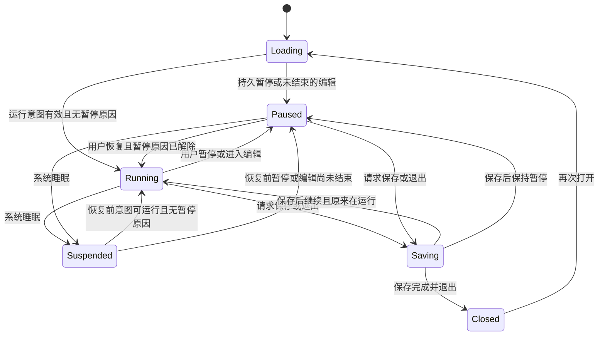

# 时间 存档与桌面生命周期

版本：0.1 审查草案。日期：2026-11-24。D = 用户明确决定；B = 当前工作基线；O = 待审查或实测。

## 1. 必须保持的用户体验

**TIME-001（D）：退出应用、电脑睡眠或关机期间，世界不进行生态推进。** 重新打开看到的是之前的个体、环境资源与生命阶段继续生活，不进行离线补算。

**TIME-002（D）：桌面时钟显示实际时间。** 生态世界恢复保存状态后，昼夜相关环境逐渐对齐现实目标。各世界保留自己的气候。

**TIME-003（B）：应用运行时，所有未暂停的世界继续推进；进入生态编辑暂停该世界；试运行采用完整副本。** 视图是否可见和生态是否运行分别处理。

**TIME-004（B）：日常速度先按 1:1 组织；季节随世界自身日历推进。** 试运行可以加速整套生态过程及其受控环境时间。倍率、季节周期和现实关联方式在审查后保留配置与明确说明。

**TIME-005（B）：运行意图与临时暂停分离。** 持久化 `runIntent` 和用户手动暂停的记录；编辑等临时暂停原因单独记录。实际是否推进由运行意图和有效暂停原因共同决定。系统挂起恢复到挂起前意图，不统一切成运行。

## 2. 三类时间与一个驱动器

| 概念 | 用途 | 是否进入存档 |
| --- | --- | --- |
| 现实墙上时钟 | 时钟组件、当前日期/时区、现实日夜目标 | 可以记录保存时刻作为元数据；不能据此补算生态 |
| 世界累计运行时间 | 年龄、摄食、生长、繁殖、分解、季节日历 | 保存，恢复后继续 |
| 环境当前节律 | 当前昼夜相位、光照与尚未完成的过渡 | 保存，恢复后连续调整 |
| 本次运行计时基线 | 计算本次会话活跃经过时间 | 不复用旧进程计时值；恢复时重新建立 |

运行层读取现实时间与平台计时；内核只接收明确的模拟时长和本步环境输入。

### 2.1 恢复示例

上次在上午退出，几天后的晚上打开：

1. 加载并验证检查点，恢复动物年龄、身体储备、水量、养分与模拟时间。
2. 为新的运行实例分配新的 `runGeneration`，建立当前会话计时基线。
3. 桌面时钟显示实际时间。
4. 恢复保存时的环境相位与过渡状态，再根据现实目标重新计算需要的调整。
5. 恢复 `runIntent` 和有效暂停原因；只有世界可运行时，才在后续模拟步中逐渐调整光照驱动，并让温度、水分、光合作用和氧气响应。用户手动暂停的世界保持暂停；编辑未结束退出的世界恢复为暂停，等待返回编辑或明确选择继续运行。

加载本身不增加年龄、不消耗食物、不改变水体物质存量。

### 2.2 同步边界

现实同步作用于配置允许的外部目标，例如昼夜节律。水温、土壤水分和溶氧不直接插值成一个外部目标读数；它们使用对应过程与边界交换计算。

世界之间的切换只改变视图绑定。B 世界读取自己的状态和同步配置，A 世界的环境数值不能成为 B 的过渡起点。

### 2.3 日夜相位与季节

昼夜是环形量，跨午夜不能把接近一天末尾和一天开始视为最大差距。保存相位、过渡目标、剩余进度或等价状态，以及控制变化速率的参数。恢复后目标未变时继续既有过渡；现实目标变化时，以当前环境状态连续地重定向。

相位变化需要限速，避免恢复时太阳、阴影和光照骤跳。是否允许相位反向调整、使用何种过渡曲线属于可解释的工程/视觉建议，首轮列出方案并在样板验证；不要把某个过渡秒数当作用户决定。

基础方案可使用明确设置的日出/日落时段。若需要真实太阳时刻，则必须定义地点、时区与计算方法；仅凭时区不能确定当地日出日落。季节对温湿度、降水等气候的影响与现实日夜来源分别配置，避免两个系统同时决定同一目标。

## 3. 运行状态机

图中状态描述运行层语义，不要求实现为同名枚举。`Saving` 表示一致检查点的保存过程，不要求在全部文件 I/O 期间停止所有世界；取得不可变快照后可异步写入，并保留原运行意图。保存失败必须返回可见错误，并保持最近有效检查点；不能显示为已经成功保存。

| 事件 | 世界处理 | 视图处理 |
| --- | --- | --- |
| 最小化或隐藏观察窗口 | 按后台运行策略继续 | 可以降低或停止绘制 |
| 关闭一个观察组件 | 不因取消订阅而删除世界 | 释放订阅及视图资源 |
| 用户暂停世界 | 持久化手动暂停和运行意图，停止该世界模拟时间累计 | 保留最后画面与暂停状态 |
| 进入生态编辑 | 加入编辑暂停原因，保留原运行意图；未结束退出时保存这一状态 | 清楚显示编辑状态；重开后提供返回编辑或继续运行选择 |
| 进入布局编辑 | 不改变世界的物理状态 | 调整组件位置和大小 |
| 系统睡眠/休眠 | 不累计睡眠时长；保留挂起前运行意图和暂停原因；尽力保存但不依赖一定收到事件 | 恢复后重建资源并返回原有效状态，不强制运行 |
| 应用明确退出 | 保存一致检查点后终止 | 结束窗口 |
| 进程异常终止 | 下次从最近有效检查点恢复 | 说明恢复来源与可能未保存的最近进度 |

**O：最后一个窗口的关闭按钮是退出还是进入托盘，以及托盘是否为首版默认。** 该行为影响用户是否认为世界仍在运行，应在产品审查中明确。菜单中的“退出应用”始终具有明确终止语义。

## 4. 计时与调度约束

### 4.1 正常延迟与睡眠分开

普通绘制变慢、CPU 暂时忙碌和系统睡眠具有不同含义。不能仅根据“时间差超过某阈值”就把全部时间丢弃，或将其全部补进世界。

Rust `Instant` 文档未统一规定各平台、各版本是否把系统挂起计入经过时间。Windows 提供的 `QueryUnbiasedInterruptTimePrecise` 不包含睡眠和休眠时间，可作为平台适配的候选能力；具体采用方式需要实机验证。[Rust Instant](https://doc.rust-lang.org/std/time/struct.Instant.html) · [Microsoft 计时接口](https://learn.microsoft.com/en-us/windows/win32/api/realtimeapiset/nf-realtimeapiset-queryunbiasedinterrupttimeprecise)

运行层应统一接收系统生命周期事件并维护计时基线。重复、延迟或缺失的恢复通知都需要有明确处理，不能触发两次恢复补步。

### 4.2 有限步长与积压

正常活跃时间进入模拟时间累积器，以固定小步推进；一次长延迟不能变成一个任意巨大的模拟步。每次调度可限制工作量，保留尚未完成的活跃时间积压。

过载先考虑减少绘制和非必要输出。如果持续无法追上日常速度，界面应显示运行落后、明确的减速或暂停状态；具体过载策略在 M0 根据实测决定。不能通过悄悄改变动物代谢或任意丢弃活跃时长来维持表面帧率。

退出后积压怎样处理需要一致定义。首版建议只保存已经完成的模拟进度，未完成的排队工作不在下一次打开时作为离线推进执行；保存信息应反映最终一致时间点。

### 4.3 加速试运行

试运行倍率作用于完整模型：年龄、摄食、生长、分解、环境过程及试验使用的受控昼夜/季节输入按同一时间方案推进。采用固定输入序列验证加速，不能一边让动物加速一边持续使用无法对应的即时现实光照。

桌面时钟始终显示现实时间。试运行界面额外显示模拟日期、已推进时长与倍率。

### 4.4 采用结果后的时间

采用试运行结果先按 [架构第 5.3 节](06-architecture-and-contracts.md) 核对 fork 基线，原世界的运行代次、编辑修订或模拟步数已经变化时拒绝静默覆盖。采纳副本的生态状态、世界时间、随机状态与当前环境节律，保留正式世界 ID、运行意图和暂停原因。

采用后使用正式世界日常倍率和环境驱动，重建本次会话计时基线，并从采纳的当前节律平滑对齐现实目标。试验用倍率、受控输入序列、临时计时器和运行模式不随生态结果写入日常运行。原本手动暂停或仍处于编辑中的世界继续暂停。

## 5. 存档内容

| 数据组 | 最低要求 |
| --- | --- |
| 文件头 | 世界 ID、存档格式版本、模型版本、内容定义引用/摘要、检查点 ID |
| 空间与材料 | 地形、表面、水域连通关系、材料状态、物理尺寸 |
| 生物 | 稳定个体 ID、位置、年龄、阶段、身体与储备、应激、繁殖、当前持续行为所需状态 |
| 环境资源 | 水量、各物质总量、环境状态、微生物/种群/植物斑块等 |
| 时间 | 模拟累计时间、步数、世界日历、环境相位、未结束过渡 |
| 随机过程 | 算法版本、完整生成器状态；若分子系统使用随机流，全部分别保存 |
| 运行过程 | 对未来有影响的待处理事件、延迟过程、必要调度语义 |
| 运行意图与暂停 | `runIntent`、与其一致的持久手动暂停记录、临时暂停原因及恢复方式；未结束编辑保留暂停等待用户返回编辑或选择继续 |
| 输入来源 | 气候配置、受控输入进度、相关缓存的来源与版本 |
| 元数据 | 保存现实时间、名称、缩略图索引、用户说明；不用于补算 |

只保存种子不足以确定已经推进后的随机状态。需要确保当前行为的后续变化可以恢复，不能在加载时重新随机一次成年年龄、食物目标或繁殖进度。

视图布局独立保存：组件位置、大小、绑定世界、相机、显示设置不混入物质与生命状态。可恢复的显示缓存不必写进生态检查点。

暂停原因应区分持久用户意图与运行环境原因。系统睡眠事件只影响当前会话的有效运行状态；重新打开应用时不把已经结束的系统挂起永久保留为暂停原因。未完成编辑则保留明确恢复入口，不能加载后自动让世界运行。若同时保存 `runIntent` 和手动暂停标记，校验二者一致，避免两个字段各自决定相反行为。

## 6. 保存与恢复流程

### 6.1 保存

1. 在完整模拟步或完整命令批次的边界取得一致状态。
2. 序列化成带版本信息的候选检查点，检查引用、长度、有限数值和基础不变量。
3. 写入临时目标并完成必要的持久写入动作。
4. 使用适合 Windows 的原子替换或等价提交方式，将候选检查点变成当前检查点。
5. 保留上一份有效版本，成功后更新世界索引和显示状态。

具体文件格式与提交 API 在审查后选择。对于文件被占用、磁盘写满、突然终止和索引更新失败，需要证明旧检查点仍可恢复。不能把“调用保存函数返回”当作所有崩溃场景都已覆盖。

### 6.2 恢复

读取文件头 → 检查支持的结构/模型版本 → 解析准确的内容定义集 → 验证数据 → 执行经测试的迁移或拒绝不支持版本 → 建立新运行代次 → 发布全量基线快照 → 按保存的运行意图恢复。

损坏文件不直接覆盖原件。可以回退到上一份有效检查点并明确说明。仅部分数据可读时，不自动拼凑出一个看似正常但资源失真的世界。

### 6.3 自动保存与恢复承诺

自动保存间隔属于可配置工程参数。强制终止可能丢失最近一次检查点后的进度；承诺应限定在已经成功持久化的状态，不能声称断电绝对零损失。应用正常退出需要尽力完成最新检查点，且失败要可见。

## 7. 内容与存档迁移

仅保存一个版本号不够，加载时还要能解析该版本对应的实际内容定义。建议使用可解析的版本化定义包，或在存档中保留必要的逻辑定义快照和摘要。

| 变更 | 处理原则 |
| --- | --- |
| 界面文字或纯显示素材更新 | 可独立更新，但保证实体映射和物理尺寸语义不变 |
| 物种响应、资源组成或材料参数更新 | 明确影响旧世界的方式，不能静默替换 |
| 存档字段结构变化 | 使用可测试的迁移函数，保留源文件 |
| 生态算法语义变化 | 升级模型版本，说明旧模型继续支持或迁移策略 |
| 缺少旧定义包 | 明确阻止加载或提供可审查的迁移；不猜测最接近的定义 |

迁移要有旧版本样本、预期变换和资源账本检查。新版本写出的文件不得被旧版本不知情地覆盖。

## 8. 必须覆盖的边界情景

- 保存于昼夜过渡中途，稍后重新打开。
- 本地时间跨午夜、修改系统时间或时区、夏令时切换。
- 用户在睡眠前暂停；恢复后仍保持暂停。
- 用户编辑尚未结束时退出；重开保持暂停并可以返回编辑或明确继续。
- 正式世界已改变后尝试采用旧试运行结果；应返回 fork 冲突并保留两份状态。
- 采用结果后恢复日常倍率和驱动，保留正式世界原运行意图。
- 保存进行中系统终止或发生写入错误。
- 快照仍在传输时切换世界、恢复旧检查点或采用试运行结果。
- 主窗口与小组件同时存在，关闭其中之一。
- 多世界使用不同气候、同步配置和暂停状态。
- 普通 CPU 积压不被误判成离线时间。

完整验收方法见 [验证计划](10-validation-plan.md)。
